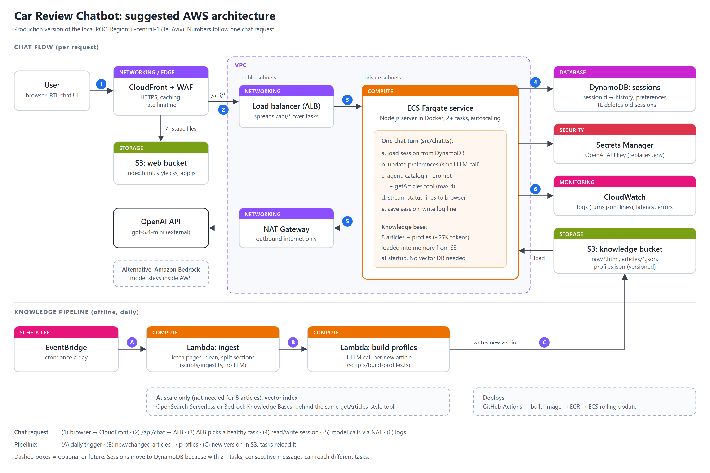

# Suggested AWS architecture

The POC runs as one Node process on a laptop. This is how the same design would run on AWS. Every box maps
to something that already exists locally, and the application code stays the same; only where things live
changes.

> I haven't deployed to AWS before. This design is based on the standard managed services for each job, kept
> as close as possible to the local version so every piece is easy to explain. It is a proposal, not
> something I have run.

## What replaces what

| Local POC | On AWS | What it does, with an example |
|---|---|---|
| `public/` served by Express | **S3** (web bucket) + **CloudFront** | S3 stores files. CloudFront is a CDN: servers around the world keep copies of the files. A user in Haifa loads `index.html` from a nearby edge server instead of from our app. |
| — | **WAF** (on CloudFront) | A firewall for web requests. Example: block an IP that sends 500 chat requests a minute (each one costs an LLM call). |
| `npm start` on a laptop | **ECS Fargate** | Runs our Docker image (code + Node + dependencies) without us managing servers. Example: "keep 2 copies running, 1 vCPU / 2 GB each, add copies when CPU is above 60%". |
| — | **ALB** (load balancer) | The single entry point for `/api/*`. Example: two copies (A and B) are running; message 1 goes to A, message 2 goes to B. If A crashes, everything goes to B. |
| `Map` in memory (`store.ts`) | **DynamoDB** | A managed key-value database. Example: `sessionId → {messages, preferences}`. It has to leave memory because message 2 may reach copy B, which never saw message 1. A TTL deletes sessions after 7 days. |
| `.env` file | **Secrets Manager** | Stores the OpenAI key encrypted; the container reads it at startup. Nobody needs the key in a file. |
| `console.log` + `logs/turns.jsonl` | **CloudWatch** | Everything the container prints goes to CloudWatch Logs as-is. Example: an alarm when the error rate goes above 2%, or a dashboard of average latency per turn. |
| — | **NAT Gateway** | The containers live in private subnets (unreachable from the internet). The NAT lets them make *outgoing* calls, i.e. to the OpenAI API, without being exposed. |
| `data/` folder | **S3** (knowledge bucket) | Holds the raw HTML, the cleaned articles and `profiles.json`, with versioning. Containers load it into memory at startup. It's about 27K tokens, so there's no database to query per request. |
| `npm run ingest` / `npm run profiles` by hand | **EventBridge** + **Lambda** | EventBridge is a scheduler (cron). Lambda runs one function and stops, paying only for those seconds. Example: every night at 03:00, Lambda fetches the article pages, cleans the changed ones, builds profiles for new ones and writes a new version to S3. |
| OpenAI API | OpenAI API, or **Amazon Bedrock** | Bedrock serves models inside AWS: no traffic leaves AWS and no third-party key is needed. With the AI SDK this is mostly swapping the provider package. |
| `git push` + restart | **GitHub Actions → ECR → ECS** | ECR stores Docker images. On push: build the image, push it to ECR, and ECS replaces the copies one at a time with no downtime. |

## One chat request, step by step

1. The browser loads the UI from CloudFront (cached files from S3).
2. The browser sends `POST /api/chat` with `{sessionId, message}`, and CloudFront forwards `/api/*` to the ALB.
3. The ALB picks a healthy ECS task.
4. The task reads the session from DynamoDB, updates the preferences, runs the agent, then writes the session back.
5. The model calls go out through the NAT Gateway to OpenAI (or to Bedrock).
6. Log lines go to CloudWatch. Status lines and the final answer stream back to the browser over the same
   HTTP response.

## Why these choices

- **Fargate rather than Lambda for the chat.** The turn streams status lines and can take 10+ seconds; a
  long-running container handles that simply, and it is the same Docker image as local. Lambda fits the
  nightly ingest well.
- **DynamoDB rather than Redis (ElastiCache).** Sessions are small key-value records. DynamoDB is durable,
  serverless and pay-per-request, with built-in TTL. Redis would be faster, but it's a cluster to size and
  manage, and nothing here needs sub-millisecond reads.
- **No vector database.** The knowledge base fits in memory and in the prompt. If the corpus grew to
  hundreds or thousands of articles, I'd add OpenSearch Serverless or Bedrock Knowledge Bases behind the same
  tool interface (the dashed box).
- **Region il-central-1 (Tel Aviv).** Users are in Israel.

## What I would check before going live

- **Cost drivers:** the NAT Gateway and the ALB have fixed hourly costs, and LLM tokens scale with traffic.
- **Auth and rate limits:** per-user limits in WAF or the app, since every message costs money.
- **Streaming through CloudFront and the ALB:** confirm chunked responses aren't buffered (timeouts, compression).
